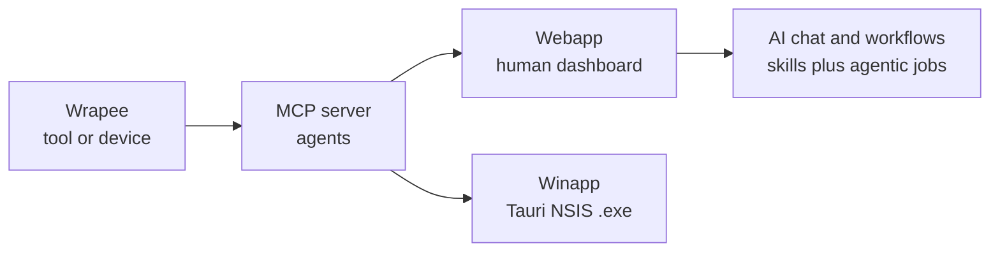

# Sandra's Repo Fleet

> Human-architected, AI-implemented: I design, agents code. [What that means](docs/AGENTIC_AI.md)

**Fleet-wide questions, AI trajectory takes, roadmap ideas?** [Discussions](https://github.com/sandraschi/sandraschi/discussions) — not tied to one repo's tools, that's what this one is for.

Retired software engineer, 9th District Vienna. I wrap everyday tools in a five-layer fleet pattern, then snap repos together into pipelines. 190+ small repos, one cohesive architecture.

Start here: **[Why so many repos?](WHY_FLEET.md)** — plain-language value prop, 3 minutes.

Each repo ships four layers wired to one **wrapee**: an **MCP server** for Claude or Cursor, **webapp** and **winapp** for humans, and **AI specialist chat and workflows** in the web stack. The wrapee itself isn't shipped — you already have it, or the repo helps you find, install, and wire it in (from Inkscape and Lean to robot cars and audio gear).

---

## What We Currently Do — Active Spheres of Interest

| Sphere of Interest | Focus & Architecture | Detail Sub-Readmes |
|---|---|---|
| **Meshed MCP Fleet** | 190+ repos wrapping tools across robotics, CAD/3D, audio/video, Calibre, and transit into a 5-layer standard. Repos run completely standalone or snap together into 1-hop crossconnect pipelines with soft degradation. | **[Why So Many Repos?](WHY_FLEET.md)** **[Full MCP Catalog](MCP_CATALOG.md)** **[Fleet Crossconnects](FLEET_CROSSCONNECTS.md)** |
| **Rustification (`r11n`)** | The next fleet regime: migrating from Python/FastMCP to pure-Rust workspaces (`<domain>-core`, `<domain>-mcp`, `<domain>-app`). Single `cargo` toolchain, sub-millisecond execution, zero `node_modules`, and zero Python runtime drift. | **[Rustification SOP](RUSTIFICATION.md)** **[Dev Stack](DEV_STACK.md)** |
| **ArtCraft 3-Tier Scaffolding** | 2026-10-17 Red-Letter standard replacing multi-process IPC: `L1 core` (pure algorithmic logic) &rarr; `L2 CLI + MCP` (headless agent tool surface) &rarr; `L3 in-process Tauri` (zero-port GUI). Clean modular boundaries with mechanical verification gates. | **[Dev Stack Architecture](DEV_STACK.md)** **[Standards Fleet](STANDARDS_FLEET.md)** |
| **Stigmergic Swarm & r11n** | Autonomous multi-agent coordination without central orchestrator bottlenecks. Agents coordinate stigmergically via shared environment traces (`.r11n/claim.json`) and declarative invariant reconciliation (`Observe -> Diff -> Act`). Ephemeral workers run in space-efficient WSL2 micro-sandboxes (OverlayFS + Git Worktrees + dynamic memory reclaim) rather than heavy, RAM-eating standalone VMs. | **[Stigmergic Swarm & WSL2 Sandboxing](docs/STIGMERGIC_SWARM.md)** **[Fritz Universal Agent](FRITZ.md)** |
| **Local LLM Sovereign Inference** | 100% local reasoning on Goliath (RTX 4090) with Bonsai 2 27B PQ2_0 and Glimmer 27B Q4. Prompt truncation proxy, aggressive KV caching, and strict $0/EUR token targets. Cloud models are an emergency fallback only (<$20/mo budget) for 1M-context sweeps. | **[Local LLM Stack](LOCAL_LLM_STACK.md)** **[Coming Next & Hardware](COMING_NEXT.md)** **[Workshop (Goliath)](WORKSHOP.md)** |
| **Own "Craft Apps" (GameCraft, DemoCraft)** | Autonomous generative engines: describe a game in a single sentence and get a validated, headless-tested Godot 4 project (`gamecraft`); scene & procedural generation (`democraft-mcp`); visual design exploration (`lookcraft`). Creative sandboxes built for agents and humans. | **[GameCraft Project](https://github.com/sandraschi/gamecraft)** **[Make / Move / Meet](FLEET_MAKE_MOVE_MEET.md)** |
| **AI-Reversing & Hardware Revival** | Static binary analysis, Ghidra decompilation over MCP (via ReVa), Directmedia format reversing, and automated unpacking to revive legacy hardware and retro systems. Currently active via `reversing-mcp` (revops), transitioning to pure-Rust `reversecraft`. | **[Reversing MCP](https://github.com/sandraschi/reversing-mcp)** **[Sneaky Feats](SNEAKY_FEATS.md)** |

---

## The idea in 30 seconds

- **One wrapee per repo, five layers.** Each repo wraps one app or device you already use (Blender, QCAD, Plex, a Yahboom robot car, Vienna transit): MCP tools for agents, a dark web dashboard, a Tauri Windows app (NSIS .exe), plus in-app AI chat fed by domain skills and agentic workflows.
- **Human faces are not decoration.** Agents act, humans approve. Watch telemetry, sign off on posts and destructive ops, hit the big red stop button.
- **Every repo has intrinsic AI.** A chat page that ingests bespoke domain skills (ask yahboom-mcp about robot types in plain words) plus agentic workflows that run multi-step jobs locally. Details: **[Why the fleet looks like this](WHY_FLEET.md)**.
- **They snap together, optionally.** Any repo runs alone. When two repos know each other they offer a 1-hop link (CAD file to 3D print to robot mount to VR twin to spoken "done"). No forced installs, friendly error if the peer is missing.

Details: **[Why the fleet looks like this](WHY_FLEET.md)** — why one repo per tool, why a webapp each, what crossconnects do, and an honest note on stars.

---

## Where to go next

| If you want... | Go to |
|---|---|
| Design things, move robots, meet in VR (the interlock chain) | **[Make / Move / Meet](FLEET_MAKE_MOVE_MEET.md)** — Blender, QCAD, FreeCAD, Resonite VR, Yahboom, Dreame, Nori, Unitree |
| Sound, video, DJ sets, knowledge, everyday Vienna life | **[Play / Know / Home](FLEET_PLAY_KNOW_HOME.md)** — Mixxx, stems, Resolume, memory, Calibre, arXiv, Plex, transit |
| Every server in one registry | **[Full MCP Catalog](MCP_CATALOG.md)** — 126+ repos by category |
| How repos link (clickable graph + rules) | **[Fleet Crossconnects](FLEET_CROSSCONNECTS.md)** — pipelines, 1-hop contract, soft degradation |
| Two deep dives, kept separate on purpose | **[Fleet Highlights](HIGHLIGHTS.md)** (mobile-DJ video fork, Lean proof loop) — **[Coming Next](COMING_NEXT.md)** (local sovereign agent, 0 EUR per token) |
| The machine and the hardware behind it | **[Workshop](WORKSHOP.md)** — Goliath, RTX 4090, Boomy, Bumi |
| Who runs this (workshop photo, Benny, follows, thanks) | **[About Sandra](ABOUT.md)** — the personal tail, kept off this page on purpose |
| How it is built (developers: tools, tests, standards, CI) | **[Dev Stack](DEV_STACK.md)** — very technical, everyone else stop here |
| Why the fleet is being rewritten in Rust (r11n) | **[r11n](RUSTIFICATION.md)** — the why, the SOP, the first six converts |
| Stigmergic swarm & WSL2 micro-sandboxes | **[Stigmergic Swarm](docs/STIGMERGIC_SWARM.md)** — autonomous repo repair without VM bloat |
| The rogues' gallery (Alexa air-gap, listening ops, live demos) | **[Sneaky Feats](SNEAKY_FEATS.md)** — mischief with guardrails |
| So you want to be a v̶i̶b̶e̶c̶o̶d̶e̶r̶ "agentic architect" | **[Vibecoding Notes](VIBECODING_NOTES.md)** — subscription round-robin, DeepSeek peak-hour gotchas |
| The wins that actually cleared a real bar | **[Our (Nontrivial) Successes](SUCCESSES.md)** — external validation, hard problems solved, real thresholds crossed |
